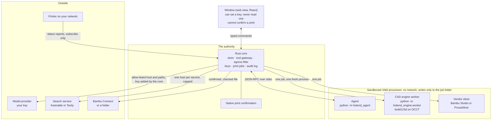
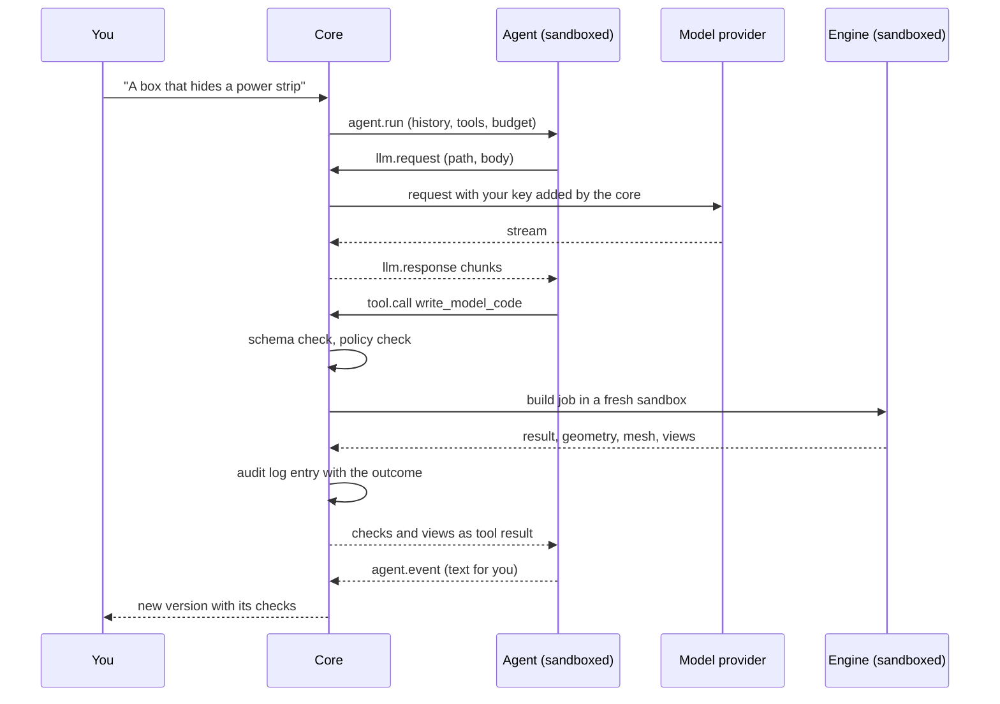
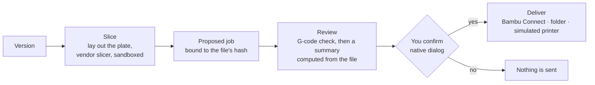

# Hotend architecture

Hotend turns a described part into a checked CAD model and then into a print job. This
document shows the components, who is allowed to do what, and the path a request takes from a
sentence to a print. The exact contracts between components are in `docs/PROTOCOL.md`; the
reasons behind the design are in `docs/DESIGN.md`.

## The idea in one paragraph

A language model is good at writing parametric CAD code and bad at being trusted. So Hotend
lets the model write code and nothing else. The code runs in a sandbox. Deterministic checks,
not the model, decide whether the result is a valid part that fits the printer. A vendor
slicer, also sandboxed, produces the print file, which is checked again. A person confirms
the print in a dialog the model cannot reach. Every step is carried out by one Rust core
that holds the secrets and the authority.

## Components



| Component | Where | What it does | Limits by design |
| --- | --- | --- | --- |
| Window | `apps/desktop/src` | Shows projects, the conversation, the 3D view, sliders, checks, plate, print review, settings | Can set a key but never read one. Cannot confirm a print. A release window has no network; a debug window loads its interface from the development server |
| Desktop shell | `apps/desktop/src-tauri` | Exposes the core's facade to the window, plus a few commands of its own (pick a file or folder, open a link, subscribe to events); owns the native print confirmation | Adds no way around the core's checks |
| Core | `crates/hotend-core` | Project store, sandboxed jobs, tool gateway, agent supervisor, egress filter, key storage, print jobs, audit log | Never runs model-written code in its own process |
| Sandbox | `crates/hotend-sandbox` | Launcher and library that confine the engine, the agent and the slicer | Refuses to run a job when confinement cannot be applied |
| Agent | `python/hotend_agent` | The conversation loop with the model (Pydantic AI) | No network socket, no key, no file outside its scratch folder and the read-only runtime, no tool of its own |
| CAD engine | `python/hotend_engine` | Runs a model script, checks it, exports, tessellates, renders, measures | No network, nothing outside its job folder |
| Proven Fit | `python/hotend_fit` | Fit contract, calibration table, feature cards, components, gauges, range sampler | |
| Slicer layer | `crates/hotend-slicer` | Detects installed slicers, applies a version policy, runs them sandboxed, reads their results as hostile input | Bundles and links no slicer code |
| Printer layer | `crates/hotend-printer` | G-code check, confirmation summary, start token, deliveries, simulated printer, read-only status listener | The application build cannot send a printer a command. A commanding LAN transport exists behind an off-by-default feature, restricted to loopback and used only by tests |
| Settings | `crates/hotend-settings` | Print settings as a closed field model with rule data and a rule engine | |
| Command line | `crates/hotend-cli` | `hotend`: a headless driver for what the application can do | Confirms a print only with `yes` typed at a terminal |

The command line and the window are two faces of the same core, which is how the end-to-end
tests run headless.

## Trust boundaries

Three rules explain most of the code.

**1. The core is the only authority.** It alone reads API keys, opens connections to model
providers, search services and printers, and touches the project store. Python never sees a
key or a printer access code. The window can hand the core a key to store and can never read
one back. The window is not trusted to confirm a print either: that takes the native dialog.

**2. Everything the model influences is confined.** The agent process, the model-written CAD
code and the slicer all run under the same launcher:

- no network (seccomp denies the socket calls; an empty network namespace where available);
  the agent alone may create an anonymous socket pair to itself, which the Python event loop
  needs,
- writes only below the job folder, reads only the job folder, the Python runtime and a short
  system list (Landlock),
- no privilege gain, no ptrace, no new namespaces, no mounts,
- time, memory and process caps, and a whole-tree kill when a limit is hit or the launcher
  goes away.

If confinement cannot be applied, the job does not run. Linux has the working backend
(Landlock and seccomp, Linux 6.2 or newer). A macOS backend is written and untested, so it is
off unless explicitly enabled. A Windows backend is planned; today Windows runs Hotend inside
WSL2. Debug builds have two development switches (run unconfined with a warning, or use
another launcher program). A few helper programs that do not run model-influenced code start
outside the sandbox: the Python interpreter once, to find its prefix, and the system's
openers for a link or a folder. `docs/notes/sandbox.md` lists each guarantee and the
mechanism behind it.

**3. Whatever comes back is hostile input.** Engine results, slicer output, sliced files and
printer reports are read with size caps, no symlinks and no path outside the job folder, and
the fields the core acts on are parsed strictly. Web pages are cleaned, framed and cut
before the model sees them. Text from a page or a file is never an instruction to the core:
it cannot add a tool, raise a cap or confirm a print.

## The agent cannot act, it can only ask

The agent is a child process that talks to the core over JSON-RPC on its standard input and
output. It has no other channel.



- **Model access** is `llm.request`: the agent hands the core a path and a body. The core
  allows only the chosen provider's host and paths, adds the key itself, and caps the
  requests and bytes of a run and the output tokens of each request. A local Ollama is
  reached over loopback without a key.
- **Tools** are requests to the core's tool gateway, which executes them: `write_model_code`,
  `set_parameter`, `sweep_parameters`, `run_checks`, `render_views`, `measure`, `read_docs`,
  `list_cards`, `list_components`, `list_print_profiles`, `print_plan`, `slice`,
  `propose_print`, `snapshot_model`, `record_source`, `web_search` and `web_fetch`. Each call
  is checked against its JSON Schema and against policy, and written to the audit log with
  a hash of its arguments and its outcome. Past a limit of refused calls in one run, further
  refusals are summarised in one entry.
- **No tool starts or confirms a print**, and no tool accepts G-code.

## From a sentence to a part

1. **Contract.** The agent states what the part must do: its parts and requirements, each
   with where the number came from. Guesses become questions for you, or research. The
   printer and material come from your settings and are recorded with every version.
2. **Research, when sizes are open.** Research is off until you agree once per source. With
   a search service (Keenable or Tavily), `web_search` and `web_fetch` are gateway tools the
   core carries out against that one host. With the model provider's own search, the
   provider searches inside the model request and the core sets and counts the allowance.
   Either way the core caps searches and fetches per message and per project. The agent
   records each source it relies on, and a size that came from the web keeps that label
   until you confirm it.
3. **Model script.** The agent writes parametric build123d code. Fits are not typed as
   numbers: they are declared through feature cards (snap lid, peg and hole, screw boss),
   and the fit resolver takes clearances from the printer's calibration table.
4. **Build.** The core starts a fresh engine process in the sandbox for this one job. The
   engine runs the script and writes exact geometry (STEP and BREP), a mesh for the viewer
   and PNG views.
5. **Checks.** On the exact geometry: valid solid, one solid per part, watertight, inside
   the build volume, no colliding parts, and `fit_pairs`, which measures every declared
   fit. Wall thickness is sampled on the mesh. Overhangs, bed contact and small features are
   warnings. A check returns pass, warn, fail or skipped, and one that could not run is
   never a pass.
6. **Version.** Every build that finishes is stored as an immutable version, marked as
   passing or as failing its checks; only a passing version is offered for printing.
   Changing a slider is a new build and a new version, and reverting never deletes anything.

## From a part to a print



- **Slice** turns each part the way it prints best, lays the plate out, and runs an
  installed vendor slicer headless inside the sandbox. Hotend detects the slicer, checks its
  version against a policy, and ships none of its code.
- **A proposed job** is bound to the SHA-256 of the sliced file. The agent can propose; it
  cannot do more.
- **The review** runs the G-code check on that file against an allow-list for the printer:
  known commands, known parameters, values in range. A file that fails cannot be confirmed
  or delivered. The summary you read (time, filament, temperatures, plate, the file's hash)
  is computed from the file. The dialog also lists any web-sourced numbers you have not yet
  confirmed, each on a labelled line. The check exists for the Bambu Lab X2D; files for
  other printers are not checked or delivered yet.
- **Confirmation** is bound to that file's hash and to the text you were shown. In the
  application it is a native dialog whose default is Cancel; in the command line it is
  `yes` typed at a terminal. The check runs again at confirmation. Neither the tool gateway
  nor the window can give the confirmation. (The development bridge used by the interface
  tests, a debug-only program with a scripted core and the simulated printer, has a test
  switch that answers dialogs.)
- **Delivery** hands the file to Bambu Connect, writes it to a folder, or runs it on the
  simulated printer. You start the print yourself.
- **Printer status** is optional and read-only: with the access code and serial number you
  enter, the listener signs in to a printer at a private address on your network,
  subscribes to its report topic and publishes nothing. Its type has no publish method.

A **snapshot** names a version so you can export it or go back to it. If that version was
printed, the exact sliced file is kept with it.

## Data on disk

```
<data-dir>/
  hotend.db                  SQLite: projects, versions, messages, audit log, settings,
                             slices, print jobs, snapshots
  hotend.lock                held by every open core
  projects/<project-id>/
    versions/<n>/            immutable once written
      model.py               the model script
      params.json            parameter values of this build
      result.json            the engine's result and checks
      model.step, model.brep exact geometry
      model.parts.json       names and colours of the parts
      built_for.json         printer, material and calibration the version was built with
      mesh.json              tessellation for the viewer
      views/                 renders for the model and for thumbnails
      prepare/               plates and the print plan
      slice/                 slicer inputs and outputs
      slicer-project/        editable slicer project and its test slice
    snapshots/<id>/          the sliced file of a snapshot whose version was printed
  jobs/<job-id>/             scratch folder of one sandboxed job, deleted after import
  handoff/                   sliced files placed for Bambu Connect
  calibration/<printer>.json calibration table
  proven-baselines.json      settings proven by a good print, per printer, plate, material
```

Keys are not in the data folder. They live in the OS keychain or, if you choose, in the
environment or in a file of your own that only the core reads.

## Extending Hotend

The layers that will grow are kept behind small interfaces and data files:

- **Printers** are data: the X2D's facts and its G-code allow-list live in
  `crates/hotend-printer/profiles`, each block of facts with a `verified` flag and its
  source; further printer and slicer-side facts live with the core and the slicer layer.
- **Slicers** sit behind one runner with a detection step and a version policy.
- **Model providers** are a table in the egress filter (host, paths, limits) plus a provider
  kind in the agent.
- **Search services** are sources behind the same research allowance.
- **Feature cards and components** are data and small modules in `python/hotend_fit`.
- **Sandbox backends** are one trait with a backend per operating system.

The core can be driven headless with JSON in and out, artefacts are self-describing, and
exchange formats are open (STEP, 3MF), so that Hotend can be driven by, or embedded in, other
tools.

## Technology

| Layer | Choice |
| --- | --- |
| Shell and window | Tauri 2, React, TypeScript |
| Core | Rust, SQLite |
| CAD | build123d on Open CASCADE (OCCT), Python 3.13, one locked environment |
| Agent | Pydantic AI, with every model request and tool call routed through the core |
| Sandbox | Landlock and seccomp on Linux |
| Slicing | Bambu Studio or PrusaSlicer as separate, user-installed programs |

`docs/DEPENDENCIES.md` lists every dependency with its licence and the reason it is here.

## Testing

`scripts/test-all.sh` is the full test run. Its summary says what ran and what was left out,
and why: tests that need a real slicer, real reference files or a paid model call run only
where those exist and are counted and named otherwise. The end-to-end tests drive the same
core the window uses, through the sandbox, with a scripted conversation in place of a model,
a stand-in slicer and the simulated printer, so the whole path runs offline. The interface
is tested in headless Chromium against a development bridge; no automated test opens the
application's own window yet.
